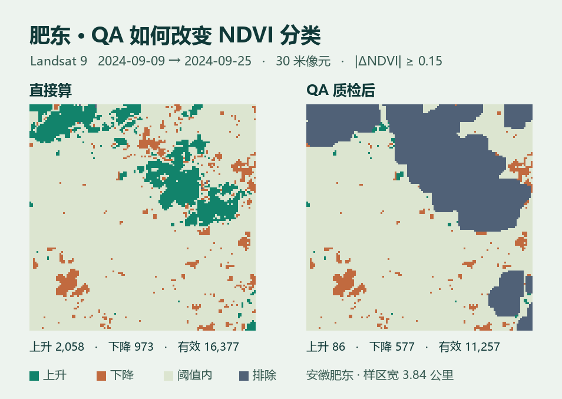

# 格证 · Landsat 遥感变化质检

在计算植被指数变化前，先检查两期栅格是否落在同一网格，再剔除云、阴影、雪、饱和和无数据像元。输出共同有效率、阈值上下的变化面积、逐像元差值以及排除原因。首版面向北向、30 米、同一 WGS84 UTM 分区的 Landsat 8/9 Collection 2 Level-2 裁片。

## 十一月验收复跑

从源码仓库根目录运行，使用 MoonBit CLI、Node.js 24 和 Python 3.10+。

```sh
python scripts/verify_shift_stress.py --quick
```

命令核对南京两期 Landsat 裁片的 SHA-256，在启用 QA 的九种取样位置上，
用 Python 有理数逐像元对照 MoonBit。阈值 0.15 时，共同有效 **10,160** 个像元，
**2,329** 个像元出现变化方向反转，变化面积上下界为 **1.0485–7.7409 km²**。
同一个共同有效区还会核对多阈值结果和重复阈值。
这个范围描述指定错位情景的敏感性。

从 Landsat 整数 DN 推导 NDVI 的分子与分母，计算两期变化时先通分求差，最后一次除法舍入为 Double。
公开测试用 NDVI 从 0.11 到 0.33 的合成栅格核对 ΔNDVI 恰好为 0.22 的分类，覆盖正反方向、相邻 Double 阈值、逐像元检查和九种取样的错位扫描。可运行 `moon test review --target native`。
独立验收脚本 `python scripts/verify_analysis.py` 还复算 20×20 合成网格在四档阈值及其相邻 Double 上的 4,800 次分类。

v0.3.0 本期新增对角偏移、面积上下界及一次扫描的多阈值曲线。
去掉 `--quick` 可核对三地真实裁片，再用独立有理数实现复算 48 对固定种子的合成栅格，每对检查 5 个阈值，覆盖双向错位、云雪和饱和掩膜。安装 Rasterio 后加 `--geotiff` 回读栅格。
[发布记录](https://github.com/jayjay9191/ge-zheng-moonbit/releases/tag/v0.3.0) · [栅格验证](https://github.com/jayjay9191/ge-zheng-moonbit/actions/workflows/verify.yml) · [裁片来源](data/nanjing/sources.json) · [许可证](LICENSE)

## 安装与复跑

在现有 MoonBit 工程中添加发布包。公开 API 见 [Mooncakes](https://mooncakes.io/docs/jayjay9191/ge-zheng-moonbit)。

```sh
moon add jayjay9191/ge-zheng-moonbit@0.3.0
```

在源码仓库根目录运行以下命令，分别检查双样区结果和外部接口。Node.js 与 Python 版本见[从新检出复跑](#从新检出复跑)。

```sh
moon run cmd/main -- data/scene-1.json data/scene-2.json 0.15 --summary
moon run cmd/main -- data/feidong/scene-1.json data/feidong/scene-2.json 0.15 --qa-impact
moon test review
python scripts/verify_local.py
python scripts/verify_analysis.py
```

### 官方影像实测与独立基线

条件为 30 米 Landsat 9 双期裁片、共同网格和绝对 ΔNDVI ≥ 0.15。统计仅归属于所取的 128×128 像元窗口。

| 场景 | 共同有效像元 | 上升 | 下降 | 独立复算 |
| --- | ---: | ---: | ---: | --- |
| [巢湖，QA 质检后](data/sources.json) | 14,224 | 10,703 | 94 | Python 有理数逐像元复算 |
| [肥东，直接算](data/feidong/sources.json) | 16,377 | 2,058 | 973 | ArcGIS Pro 3.7.1 与 Python 分别复算 |
| [肥东，QA 质检后](data/feidong/sources.json) | 11,257 | 86 | 577 | ArcGIS Pro 3.7.1 与 Python 分别复算 |

肥东在 0.10、0.15、0.20 三档的结果见[阈值对照](#肥东实测--一分钟演示)。[ArcGIS Pro 记录](docs/feidong-arcgis.json)覆盖肥东 0.15 档两个 QA 模式。ArcPy 从地理参考栅格独立算出 NDVI，核对分类、NoData、面积和差值。Python 分数实现另覆盖双样区与三档阈值。

GIS 工作流可用栅格计算器、掩膜和区域统计实现同样的分类。格证把[共同网格校验与 QA 位掩膜](audit.mbt)、[跨阈值计数](sensitivity.mbt)和[逐像元审计](audit.mbt)放在可从项目复用的 MoonBit 库中。一次复跑即可对照掩膜前后的计数，并追到被筛除的像元。用于外部核对的 GIS 栅格和复算步骤见 [ArcGIS Pro 复算](#arcgis-pro-复算)。

### 边界与未完成事项

- 支持现有输入契约下的北向、30 米 Landsat 8/9 Collection 2 Level-2 裁片。两期须在同一 WGS84 UTM 分区，交叠网格须按整像元对齐。
- 核心读取项目定义的裁片 JSON。标准源资产可通过 Python 预处理转成裁片。其他传感器、跨投影重采样和旋转栅格改正尚未覆盖。
- 独立基线包含两个样区，每个样区两期。NDVI 分类只描述阈值上的变化，地类归因需要额外地面证据。

### 双样区运行基准

在 Windows、AMD Ryzen 9 8940HX、Node.js 24.19.0 上，以下两个已编译 CLI 调用连续执行 5 轮。每轮各启动两次 Node.js，包含读取 JSON、计算和输出，排除编译。中位数约 320 ms，范围 283–324 ms。

```sh
node gezheng.js data/scene-1.json data/scene-2.json 0.15 --summary
node gezheng.js data/feidong/scene-1.json data/feidong/scene-2.json 0.15 --qa-impact
```

先用 `python scripts/verify_local.py` 生成 `gezheng.js`。单机结果用于后续同环境回归比较。

## 空间错位压力测试

按对齐位置和东、西、南、北各一像元取第二期观测。五个情景共享同一内区和有效像元集合，某一情景被 QA 排除的像元从五组同时剔除。这样面积差异反映配对位置变化。行列偏移是对第二期栅格的取样方向。0.15 指绝对 ΔNDVI 阈值。一个像元是 30 米的压力参数，报告范围是所测五组的最小值与最大值。

```sh
moon run cmd/main -- data/nanjing/scene-1.json data/nanjing/scene-2.json 0.15 --shift-stress
python scripts/verify_shift_stress.py
```

| 样区，启用 QA | 共同有效像元 | 分类受偏移影响 | 变化面积范围 |
| --- | ---: | ---: | ---: |
| 巢湖 | 13,772 | 1,720 | 9.4500–9.6579 km² |
| 肥东 | 10,915 | 4,612 | 0.5715–1.9809 km² |
| 南京 | 10,328 | 6,037 | 1.9917–3.6360 km² |

[南京新增样区](data/nanjing/sources.json)采用 Landsat 9 轨道 120/038 的 2024-05-13、2024-10-04 两期产品。裁片尺寸为 128×128，清单记录原始资产网址、像元窗口与 SHA-256。巢湖和肥东用原有裁片。三地分别以启用 QA 和直接算复跑，共六组。Python 有理数逐像元对照分类、变动数量和地理窗口。

`--shift-stress` 的 JSON 包含稳定性栅格。像元值 −1、0、1 表示五种配对一致为下降、阈值内或上升。2 表示偏移会改变分类，−2 表示无共同有效数据。保存为 UTF-8 JSON 后，使用 `python scripts/export_geotiff.py alignment.json output` 输出 GeoTIFF。安装 Rasterio 后用 `python scripts/verify_shift_stress.py --geotiff` 通过 GDAL 重新读回坐标、NoData、掩膜和每个像元。

### 逐像元变化面积上下界

在同一个共同有效区内，对五种情景的变化掩膜取交集和并集。交集面积
`certain_change_m2` 计入五种取样都超过阈值的像元，即使其中方向反转。
并集面积 `possible_change_m2` 计入至少一种取样超过阈值的像元。
`opposite_direction` 计数同时出现过上升和下降的像元。公开接口
`alignment_stress_with_bounds` 同时返回既有情景分析与新的上下界，CLI 在
`pixelwise_change_bounds` 中输出新字段。

| 启用 QA | 五种整图统一偏移下的变化面积 | 允许逐像元选择偏移的上下界 | 方向反转像元 |
| --- | ---: | ---: | ---: |
| 巢湖 | 9.4500–9.6579 km² | 8.7408–10.2861 km² | 46 |
| 肥东 | 0.5715–1.9809 km² | 0.2016–4.3389 km² | 437 |
| 南京 | 1.9917–3.6360 km² | 1.2348–6.5115 km² | 1,412 |

逐像元上下界允许各位置取不同偏移，因此范围更宽。两种范围均针对这五种
假设取样和共同有效区。独立脚本用 Python 有理数重新计算掩膜与交并集，
并检查每组整图面积都落在逐像元上下界内。

### 对角偏移补测

在 `--shift-stress` 后加 `--include-diagonals`，可检查完整 3×3 取样窗口。
所有九个情景仍共享有效像元集合，公开接口可传 `include_diagonals=true`。

```sh
moon run cmd/main -- data/nanjing/scene-1.json data/nanjing/scene-2.json 0.15 --shift-stress --include-diagonals
python scripts/verify_shift_stress.py --geotiff
```

| 样区，启用 QA | 九种取样均有效 | 同一批像元中因补测对角而判为不稳定 | 九种取样的像元级变化面积上下界 |
| --- | ---: | ---: | ---: |
| 巢湖 | 13,766 | 723 | 8.4015–10.5939 km² |
| 肥东 | 10,915 | 1,672 | 0.1260–5.7735 km² |
| 南京 | 10,160 | 1,654 | 1.0485–7.7409 km² |

比较时先固定九种取样均有效的像元，再统计在仅看水平、垂直和原位时分类一致，
加入对角后分类不一致的像元。独立脚本复算三地、两种 QA 设置、两种偏移方式，
并通过 GDAL 验证 GeoTIFF 坐标、掩膜和像元值。对角取样在每个轴上偏移 30 米，
直线距离约 42.4 米，属于压力测试设定。

### 一次扫描输出多阈值曲线

```sh
moon run cmd/main -- data/nanjing/scene-1.json data/nanjing/scene-2.json --shift-sweep 0.20,0.10,0.15,0.15 --include-diagonals
moon bench analysis_wbtest.mbt --target js
```

`alignment_threshold_sweep` 在同一有效区内取像元跨偏移的最小变化幅度、最大变化幅度和
正负两个方向中较弱的最大幅度。对阈值排序，把每个幅度用二分定位到分箱，再做后缀
累计。第二期只缓存三行 NDVI 和 QA 状态，供相邻像元重用。设有 P 个像元、S 个偏移和 T 个阈值，时间复杂度为
O(P·(S + log T) + T·log T)。输出保留请求顺序和重复阈值，并包含等于阈值的像元。

三地分别用两种 QA 设置和两种偏移方式复跑，共 **60 行**曲线结果逐项与 Python 有理数
独立复算一致。另将南京两期分别裁小，验证行列偏移为正或为负时的 10 行边界结果。
在 Windows、Ryzen 9 8940HX、Node.js 24.19.0、MoonBit 0.1.20261117 上，
南京九种偏移、25 个阈值的单进程基准，逐阈值调用平均 57.01 ms，批量方法平均 2.75 ms。
测量排除读文件与启动，逐次调用同时生成稳定性栅格，批量接口输出面积摘要。这组数据
用于对照本机接口耗时。

[USGS 配准说明](https://www.usgs.gov/landsat-missions/landsat-geometry)

## 初审核对

在仓库根目录运行 `moon test review`。[公开接口案例](review/public_contract_test.mbt) 覆盖 QA 与陆地筛选、拒绝不守恒的矩阵、多档迁移和阈值容差。真实裁片可用下面的命令复跑。

运行 `python scripts/verify_analysis.py`。库源码排除 CLI、生成数据、测试、空行和注释后共 **1,878 行**，再排除纯标点行仍有 **1,558 行**。脚本逐文件报告计数并检查 500 行门槛。

[肥东两期裁片](data/feidong/)在 0.15 阈值下，QA 剔除前有 **3,031** 个达阈值像元，剔除后有 **663** 个。这个结果来自 MoonBit 的 [QA 配对审计](impact.mbt)。同一验收脚本还以 Python 有理数运算独立对照肥东和巢湖的 NDVI 分类，共核对 **196,608 次像元比较**。

多阈值扫描按变化幅度定位命中的阈值，再累加计数。输出保留请求顺序和重复阈值，恰好等于阈值的像元计入变化。命令行拒绝重复开关，防止后一个参数覆盖前一个。双向偏移和精确阈值边界由同一复跑脚本检查。

## NDVI 分段转移矩阵

```sh
moon run cmd/main -- data/feidong/scene-1.json data/feidong/scene-2.json --transitions 0.2,0.5
```

矩阵的行是第一期、列是第二期。分界值归入较高档，两期均有效才计入矩阵。示例 3×3 矩阵共有 11,257 个有效像元，其中从中档进入高档 160 个，从高档进入中档 483 个。分界值由调用方按分析目的提供。它们用于 NDVI 分段统计。

添加 `--land-only` 可只分析两期均未标为水体的有效像元。肥东质检后原有 11,257 个有效像元，再排除 45 个水体像元，余 11,212 个。输出 `water_excluded` 是排除总数的子集。覆盖率继续按整个共同窗口计算，并写入 `valid_fraction`。公开返回值保留 `qa_screened` 和 `land_only`，CLI 的 `sources` 列出两期场景标识、采集日期和共同 EPSG。

其他 MoonBit 项目可导入 `jayjay9191/ge-zheng-moonbit` 并调用 `ndvi_transitions(before, after, [0.2, 0.5])`。接口用共同网格读取两期 NDVI，支持现有质检开关和最低有效覆盖率。验收脚本按地面坐标匹配，以分数计算独立核对两个真实样区的矩阵。

命令的 `summary` 字段包含两期各档总数，以及升档、同档和降档像元数。肥东示例中，升档 **177**、同档 **10,553**、降档 **527**，三项之和等于有效像元数。这里的升降指跨越设定的 NDVI 分界值，不能由此推断地类变化。

外部项目可用 `summarize_ndvi_transitions(matrix)` 校验并汇总已持有的矩阵。接口拒绝非方阵、负计数和与有效像元总数矛盾的数据。复跑脚本逐项对照原裁片的矩阵和汇总结果。

### 分解跨档差异

`quantity_disagreement` 是两期各档数量差绝对值之和的一半，表示即使位置匹配达到最大，档位数量变化仍必然产生的差异。`allocation_disagreement` 是所有跨档像元减去数量差异，表示各档数量净变化无法解释的空间配置差异。两项均以共同有效像元计数。若两个像元交换档位，数量差异为 0，配置差异为 2。

肥东在 QA 筛选下有 **704** 个跨档像元，分解结果为 **323 个数量差异 + 381 个配置差异**。交换两期两个值保持不变。巢湖、肥东的 QA 与陆地模式均由独立参考脚本复核。方法参考 [Pontius 与 Millones](https://commons.clarku.edu/faculty_geography/760/)。

`summary.bands` 按切点顺序列出每档的留存、流入、流出、净变化和交换项。流入与流出中的较小值计为该档的交换项，各档相加等于配置差异。肥东中档留存 1,291，流入 500，流出 204，净增 296，交换项为 204。交换两期后流入与流出互换、净变化反号。复跑脚本从独立转移矩阵核对这些字段。

`summary.cut_crossings` 按切点列出上穿 `up`、下穿 `down` 和净变化 `net`。每个像元会计入它跨过的每个切点，因此跨切点次数之和可能大于跨档像元数。实现为每个非对角单元登记一个切点区间，再做前缀和，复杂度为 O(k²)，其中 k 为档位数。肥东 QA 筛选下，0.5 切点有 **160 个上穿、483 个下穿**，净减 323 个。独立 Python 脚本直接比较两期每个有效像元与阈值的大小关系，并检查反向计算后上穿与下穿互换。

### 阈值容差

```sh
moon run cmd/main -- data/feidong/scene-1.json data/feidong/scene-2.json --transitions 0.5 --margin 0.01
```

`ndvi_threshold_bounds` 复用共同网格及筛选逻辑，将切点与切点 ± 容差一起分档。每个方向分别给出必然跨越 `guaranteed`、观测跨越 `observed` 和可能跨越的最大数量 `possible`。假定每个有效像元的两期 NDVI 可在给定容差内独立变化，两端点须在 (-1, 1) 内。上下穿的上限分别计算，不能相加。容差是输入假设，取零时三种计数一致。

肥东 QA 样区的 0.5 阈值在 ±0.01 假设下，上穿为 **88 / 160 / 247**，下穿为 **352 / 483 / 647**。即便把上穿取上界、下穿取下界，下穿也至少多 105 个。两个样区共八组筛选由 Python 有理数对每个像元的区间端点复算。

输出 `net` 给出上穿减下穿的精确下界、观测净值和精确上界。净值等于后期在切点上方的像元数减去前期的同类计数。按独立扰动假设，将两期朝相反方向推至容差端点即可实现极值。肥东净值为 **−559 / −323 / −105**，整个区间都为负。Python 逐像元枚举两期的四种端点组合校验结果。

`ndvi_margin_sweep` 将最多 7 档递增容差的端点合入一张矩阵，只遍历一次配对栅格。之后用每期边际计数的后缀和计算每档净变动，输出首次无法排除零的**已测试容差**。在上面的命令中将 `--margin 0.01` 换成 `--margins 0,0.01,0.02,0.05` 即可复跑。肥东 ±0.01 净变动全为负，±0.02 的上下界为 **−769 至 +111**。巢湖在本次最大容差 ±0.05 仍为 **+1,155 至 +2,373**。Python 从两期像元值逐档独立复算。

`ndvi_critical_margin` 解析求出净变动首次可能到零的容差下确界。在上面的命令中换成 `--critical-margin` 即可复跑。算法按距阈值的距离排序，取能抵消名义净差的第 k 个单像元事件。向上跨过切点允许刚好落在切点，向下则须严格低于切点。距离相同时先计入在边界已经生效的事件。

肥东在 0.5 阈值下的临界容差约为 **0.0151130138**，边界本身可达到零。巢湖约为 **0.1461263028**，须略高于边界。模型仍假设两期每个有效像元可独立扰动。实现用双精度计算距离，独立 Python 有理数复核八组筛选结果和边界可达性。

`neutralization` 从同一张容差矩阵计算净变化归零所需的最少像元对。可向归零方向改一步的像元对计入 `single_step_pairs`，两期都能改且合计可走两步的计入 `double_step_pairs`。在 NDVI 0.5 阈值、±0.02 容差下，肥东要抵消 323 个像元的净减少。用完 47 个两步对，再用 229 个单步对，最少 **276 对**。缩小到 ±0.01 后无法归零，结果省略 `minimum_changed_pairs`。Python 独立枚举每个像元对的四种端点组合，核对两地、两档容差、四种筛选。

在 `--transitions 0.5 --margin 0.02` 后加 `--witness` 可输出归零见证。MoonBit 的 `NdviPairFlip` 枚举区分翻转前期、后期或两期。坐标使用第一期栅格的零基行列。肥东见证有 276 个不重复像元对，Python 按坐标重查两期读数和 QA，并逐项重放，净变化准确从 −323 到 0。无解时 `witness` 为 `null`，原本为零时是空数组。默认最多输出 1024 对，超限会报错。

## 两期共用同一 NDVI 偏移

```powershell
moon run cmd/main -- data/feidong/scene-1.json data/feidong/scene-2.json --transitions 0.5 --calibration-margin 0.02
```

假设两期所有共同有效像元使用同一个加性 NDVI 偏移，检验固定分类阈值对系统偏移的敏感性。MoonBit 从原始数字量求 NDVI，比值相同的像元同时跨阈值，避免把跳过零误记为能达到零。肥东在 ±0.02 内始终为净减少 **295 到 363 个像元**。巢湖在相同条件下仍为净增加 **1,603 到 1,911 个像元**。独立 Python 参考以有理数逐个重算两期分布，在两处裁片、四种 QA/陆地配置及两个容差下核对 16 组结果。[USGS 比例系数](https://www.usgs.gov/faqs/how-do-i-use-a-scale-factor-landsat-level-2-science-products)

## 像元预算下的最小容差

```powershell
moon run cmd/main -- data/feidong/scene-1.json data/feidong/scene-2.json --transitions 0.5 --pair-budget 162
```

每个像元对最多抵消两步。MoonBit 按翻转距离排序，一次扫出每个临界点能提供一步或两步的像元对数量。肥东净迁移为 −323，允许 161 对时无解，162 对时临界容差约 0.05327544，须严格超过该点。允许 276 对时约 0.01979154，端点可达。结果基于阈值分类的数学模型，表示在给定预算下净值归零的条件。`python scripts/verify_analysis.py` 使用有理数计算候选半径，再直接重算指定数量像元所能抵消的幅度。

同一裁片可一次检查多档预算。算法按预算从大到小分配首个达标的翻转事件，再按输入顺序输出。乱序和重复预算都会保留。P 为有效像元对数，B 为预算数，排序和扫描的总时间为 O(P log P + B log B)。

```powershell
moon run cmd/main -- data/feidong/scene-1.json data/feidong/scene-2.json --transitions 0.5 --pair-budgets "323,161,276,162,162,0,323"
```

## 验收外部像元见证

将 `--witness` 输出中 `witness` 数组单独保存为 JSON。在相同裁片、阈值、容差和筛选配置下，用 `--verify-witness <JSON 文件>` 替换 `--witness`。MoonBit 使用 `Result` 返回验收结果。错误枚举分别保留重复坐标、无有效覆盖、越容差、净变化未归零及可以用更少像元对完成的证据。肥东 276 对见证经独立回查和验收，追加一个重复坐标会被拒绝。

## v0.1.1：先复跑新增分析

阈值扫描、QA 配对影响和分块统计均由 MoonBit 计算，Python 只做独立复核与渲染。
在仓库根目录执行：

```sh
moon run cmd/main -- data/feidong/scene-1.json data/feidong/scene-2.json 0.15 --sweep
moon run cmd/main -- data/feidong/scene-1.json data/feidong/scene-2.json 0.15 --qa-impact
moon run cmd/main -- data/feidong/scene-1.json data/feidong/scene-2.json 0.15 --tiles 2x2
moon run cmd/main -- data/feidong/scene-1.json data/feidong/scene-2.json 0.15 --regions 4
python scripts/verify_analysis.py
```

肥东三档阈值的 QA 后增/减分别为 155/1495、86/577、49/290；同阈值 0.15 下
变化像元 3031 → 663，QA 新增排除 5120；分块各类合计与整窗一致。
CI 使用独立的 Python 有理数实现复算巢湖和肥东两个真实窗口，覆盖三个阈值和
有无 QA 筛选的两种模式，共 196,608 次像元比对。检查分类、水体码和有效像元的
NDVI 差值舍入为 Double 后逐个相等，并逐块验证三种划分的边界与类目计数。
输入裁片以清单 SHA-256 核验。执行上面的 Python 命令即可复跑。

对照复跑另含一个南向和东向同时偏移、两期裁片尺寸不同的合成窗口。它分别检查
正反顺序、两种 QA 模式和重复阈值，位置和 NDVI 由独立实现核对。每次阈值扫描只算
一遍各期 NDVI，在同一次遍历内累加各阈值结果。逐像元证据要求完整交叠窗口，核对
所选像元的两期 NDVI、水体码、差值与分类。

如果直接模式有可用信号，而 QA 剔除了全部交叠像元，默认覆盖门槛下
`--qa-impact` 会给出筛选前计数、筛选后有效数 0 和排除数量，并提示变化无法判断。
普通比较和显式正覆盖门槛仍拒绝该窗口。

单像元查询 `--inspect` 直接按交叠位置读取两期源值，无需建立整幅结果网格。
目标像元可用且覆盖门槛为默认值时，只计算该像元的 NDVI。设置了正覆盖门槛或
目标像元被剔除时，会扫描交叠区域验证覆盖。CI 对照完整网格验证坐标、类别和差值。

连通斑块统计 `--regions [4|8]` 分开计算增加与减少的斑块数、孤立像元数和最大斑块面积。
4 邻接只算共边，8 邻接也算共角。QA 排除和稳定像元不会连接斑块。
肥东阈值 0.15 下，4 邻接的减少斑块有 94 个，8 邻接有 85 个，两者最大斑块
均为 128 像元（115,200 平方米）。CI 用独立遍历对照巢湖和肥东。
分块和斑块命令只保留分类与水体标记两张栅格。完整比较仍提供两期 NDVI、差值和质检证据。
参考 [Rasterio 的按波段与窗口读取](https://github.com/rasterio/rasterio/blob/main/docs/topics/reading.rst)。

使用 `--regions 4 --min-region-pixels 4` 可只统计至少 4 个像元的斑块。
输出分别给出保留和筛除的斑块数、像元数。默认门槛为 1。阈值与 QA 产生的整窗统计仍可单独复核。
加 `--land-only` 可对两期均未标水体的变化像元单独统计。水体及水陆转换不会连接陆地斑块，
输出的 `water_excluded_pixels` 可核对按水体排除的像元数。
设计参考 [Rasterio 对栅格连通性的说明](https://github.com/rasterio/rasterio/blob/main/rasterio/features.py)。

45 项 MoonBit 测试通过。公共分块接口在乘法与数组访问前
验证窗口尺寸，拒绝超出 2048×2048 的构造输入。算法公式与更多参数见下文。
源码版本为 0.1.1；Mooncakes 新包尚待登录后发布，下方离线发行包仍为旧版 0.1.0。

初审核对入口：[`sensitivity.mbt`](sensitivity.mbt) 做同源多阈值比较，
[`impact.mbt`](impact.mbt) 做质检配对，[`tiles.mbt`](tiles.mbt) 做空间分块；
[`analysis_wbtest.mbt`](analysis_wbtest.mbt) 给出真实样窗与错误输入断言。
`verify_analysis.py` 在 CI 中实际复跑这些 CLI，并独立列出排除测试、生成数据和 CLI
后的有效源码行数（去空行与行首注释）。此门槛只证明这个计数口径，不代替评审对有效代码的认定。

三轮追加复核：逐像元证据现在检查来源标识、日期、网格完整性和对齐关系，并复用
原 QA/NDVI 算法复核所选像元；混用影像、截断网格、改动原因或分类都会拒绝。
这是所选像元的一致性检查，不是整景影像的密码学身份认证。阈值检查由公共入口统一，
即使用 `--sweep`，位置参数中的非法阈值也不会被忽略。反例：
`moon test -f 'pixel evidence rejects*'`。

再次三轮复核补上整窗一致性：分块结果必须同时满足原网格与整窗的增、减、稳定、
有效、排除及覆盖总数；篡改总数会拒绝，失败后可继续处理正确输入，原网格不被修改。
反例与恢复检查：`moon test -f 'tile counts cannot*'`。

## 肥东实测 · 一分钟演示

以同为 30 米的两期 Landsat 9 影像比较 NDVI。使用 QA 波段后，有效像元从 **16,377** 降至 **11,257**，其中有 **2,368** 个原本超过变化阈值的像元被筛除。ArcGIS Pro 3.7.1 独立复算后，两个模式的分类、面积和 NoData 掩膜与 MoonBit 全部一致。

[下载一分钟 MP4](docs/feidong-60s.mp4) · [ArcGIS Pro 逐像元复算记录](docs/feidong-arcgis.json)



| ΔNDVI 绝对值阈值 | 直接算上升 / 下降 | QA 质检后上升 / 下降 |
| --- | ---: | ---: |
| 0.10 | 2,344 / 2,376 | 155 / 1,495 |
| 0.15 | 2,058 / 973 | 86 / 577 |
| 0.20 | 1,816 / 476 | 49 / 290 |

三档阈值的六组结果均用独立分数实现逐像元复核。分类数量随阈值改变，共同有效覆盖保持不变。

## 开始

[下载离线验收包](https://github.com/jayjay9191/ge-zheng-moonbit/releases/download/v0.1.0/gridproof-offline.zip)并解压，可以直接打开两份 HTML。包内附预编译的 `gezheng.js`、真实样例和复跑脚本。GitHub 源码检出可用 `python scripts/verify_local.py` 重新生成同一组产物。

[GitHub Actions 自动验收](https://github.com/jayjay9191/ge-zheng-moonbit/actions/workflows/verify.yml)

1. 双击 **格证-实测报告.html** 查看两期 NDVI、变化分类、三组验证和像元查询。可切换 0.10、0.15、0.20 三档阈值，也可以只看两期 QA 均未标水的区域。报告可以离线打开。
2. 双击 **试跑.cmd** 重跑全部用例。需要 Node.js 22.3+ 与 Python 3.10+。样例已随包提供，复跑无须下载数据或安装第三方 Python 包。
3. 比较自备的同规格裁片，用编译产物执行：

```console
node gezheng.js data/scene-1.json data/scene-2.json 0.15
```

输入格式按样例 JSON，包含两个波段、QA_PIXEL、QA_RADSAT、影像日期及左上角投影坐标。四个波段数组按从上到下、行内从左到右展平。转换脚本验证原始 COG 的方向和分辨率，使用裁片原值。CLI 要求填入真实网格元数据，输入 JSON 自身不保留旋转参数。错误输入或无法比较时返回非零退出码并说明原因。

## 实测

安徽巢湖附近，Landsat 9 轨道/行号 121/038，分别于 2024-04-18、2024-10-11 获取。每期裁片 128×128，像元 30 米，共 16,384 个。来源链接、资产窗口坐标与 SHA-256 见 **data/sources.json**。

| 实验 | 可复现结果 |
| --- | --- |
| 同景对照，2024-04-18 与自己相比 | 14,226 个共同有效像元，最大绝对 NDVI 差为 0 |
| 半像元错位，保持真实第 1 期波段并把网格起点向东移动 15 米 | 拒绝计算面积，退出码 2。该人为构造用例验证坐标检查 |
| 两期变化，阈值 \|ΔNDVI\| ≥ 0.15 | 14,224 个共同有效像元（86.82%）；10,703 个上升、94 个下降、3,427 个在阈值内、2,160 个排除 |
| 独立核对 | 用精确分数计算复核全部 16,384 个像元的掩膜和分类。差值与分数舍入为 Double 的结果逐像元相等，三档阈值的分类均一致 |

0.15 档估算 NDVI 上升面积 **9.6327 km²**、下降面积 **0.0846 km²**。这是跨季节的 NDVI 指标变化和投影平面面积。图只覆盖所取样区，无法凭这两期数据归因或认定土地利用变化。当前按 USGS 公开范围过滤反射率，QA 同像元多种问题时按填充、云、阴影、雪、饱和、反射率异常顺序计首项。面积仅统计两期均有效的像元。

另一个关键发现：在 10,703 个上升像元中，10,647 个（99.48%）至少一期被 QA_PIXEL 第 7 位标为水体。两期均未标水的 1,141 个有效像元中，56 个上升（0.0504 km²）、82 个下降（0.0738 km²）。水体标记来自卫星产品 QA，不能单独作为地面水域边界的认定。


## 肥东陆地对照

2024-09-09 与 2024-09-25 的 Landsat 9 影像同轨同网格，时间相隔 16 天。QA 质检后共同有效像元中，99.60% 两期均未标水。两种模式均检查网格并使用相同反射率处理、30 米像元和 0.15 阈值。直接算模式只跳过 QA_PIXEL/QA_RADSAT 筛选。

| 口径 | 有效像元 | 上升 | 下降 |
| --- | ---: | ---: | ---: |
| 直接算 | 16,377 | 2,058 | 973 |
| QA 质检后 | 11,257（68.71%） | 86 | 577 |

额外排除 5,120 个像元，其中 2,368 个在直接算中超过阈值。保留下来的像元在两种模式中的差值和分类逐个相同。独立整数分数复算覆盖两种模式的全部 16,384 个像元。被筛掉的区域留作未知，两期都保留的指数差异也不能独自证明地面成因。

打开 **格证-肥东对照报告.html** 并点“定位一处被筛除的像元”，查看第 10 行、第 14 列。该像元直接算为 +0.7849，第一期 QA 标云后排除。用 python scripts/replay_land.py 和 python scripts/render_land.py 离线复跑。原始产品链接、窗口及哈希见 **data/feidong/sources.json**。

## 从新检出复跑

安装 MoonBit CLI、Node.js 22.3+ 和 Python 3.10+。在仓库根目录运行 `python scripts/verify_local.py`。入口自动跑 MoonBit 测试、从源码构建 JS、核对肥东覆盖门槛和像元证据，再复算两地案例并重建两个离线报告。验收不需要联网或安装第三方 Python 包。已有 `gezheng.js` 的验收包可以直接用试跑.cmd。

## 实现与验证

AI 用于辅助整理技术说明、生成测试初稿和对照脚本。本版使用 Codex 辅助实现分箱累计、三行滚动缓存及复跑脚本。 计算依据保留在 MoonBit 源码与 USGS 裁片元数据中，发布前用固定样区的独立 Python 算法、ArcGIS 结果和公开接口测试交叉核对。

MoonBit 执行网格校验、求交、QA 位运算、反射率换算、NDVI、分类和面积统计。Node.js 负责命令行输入输出。Python 下载裁片、用分数独立验算并渲染报告。可用 MoonBit 编译器重新构建：

```console
moon test
moon build --release --target js
```

编译产物位于 _build/js/release/build/cmd/main/main.js，用它替换 gezheng.js 后重跑。重新获取官方原始影像裁片时，在独立 Python 环境安装 requirements-fetch.txt，然后运行 python scripts/fetch_landsat.py。该步骤需要访问 Planetary Computer 及其公共 Landsat 资产，不影响已打包的离线复跑。

参考 [USGS Landsat QA 波段](https://www.usgs.gov/landsat-missions/landsat-collection-2-quality-assessment-bands)、[USGS 反射率换算](https://www.usgs.gov/faqs/how-do-i-use-a-scale-factor-landsat-level-2-science-products)、[Planetary Computer 的 Landsat 数据集](https://planetarycomputer.microsoft.com/dataset/landsat-c2-l2)。


### 共同有效覆盖门槛

CLI 可用 `--min-coverage 0.70` 设门槛。肥东样例的共同有效覆盖为 68.71%，设 0.70 时会停止输出面积。门槛由用户按任务设定，默认只要求有共同有效像元。

### 追溯一个像元

运行 `node gezheng.js data/feidong/scene-1.json data/feidong/scene-2.json 0.15 --inspect 10 14`。按共同网格的 1 起算行列输出投影坐标、两期 B4/B5、QA 位值、每期去留原因和差值。已排除的差值为 JSON null。

### 导入 GIS 软件

使用已安装 requirements-fetch.txt 的 Python，运行 `python scripts/export_geotiff.py results/feidong/screened.json results/feidong/gis`。两张 GeoTIFF 保留共同网格坐标，排除像元写 NoData。分类为 -1 下降、0 阈值内、1 上升，另一张保存实际 NDVI 差值。导出前拒绝异常分类码、非有限差值和两层掩膜不一致。完整脚本通过 GDAL 回读南京真实裁片的分类与差值，并逐像元和独立计算对照。

### 分析本地 Landsat 裁片

使用 `python scripts/pack_local_tiffs.py --help` 查看如何把本地 SR_B4、SR_B5、QA_PIXEL、QA_RADSAT 变成输入 JSON。应来自同一 Landsat 8/9 Collection 2 Level-2 场景，使用原始 UInt16 值。脚本检查四个 TIFF 的 CRS、分辨率、原点、方向和尺寸，拒绝不一致的波段，保留原始像元。

### 轻量汇总

批处理只看变化面积、覆盖和剔除项时，CLI 加 `--summary`。MoonBit 不保留逐像元数组，汇总口径保持一致。导出地图或追溯像元时使用完整输出。


### ArcGIS Pro 复算

先运行离线验收，再用已安装 `requirements-fetch.txt` 的 Python 导出 MoonBit 的两组栅格：

```console
python scripts/verify_local.py
python scripts/export_geotiff.py results/feidong/direct.json results/feidong/gis/direct
python scripts/export_geotiff.py results/feidong/screened.json results/feidong/gis/screened
```

在 **ArcGIS Pro 自带的 Python 环境**中从仓库根目录运行 `python scripts/verify_arcgis.py`。脚本将裁片的 B4、B5 和两组 QA 原值写入带地理参考的 GeoTIFF，用 ArcPy 读取后独立计算 NDVI，再对比 MoonBit 的逐像元分类与导出栅格。输出位于 `results/feidong/arcgis`，包括验证 JSON 和可加载到 GIS 的图层。第 10 行第 14 列因第一期标云被剔除，第 11 行第 43 列保留（ΔNDVI +0.180065）。
# 三项原生分析（0.1.1）

对同一对芯片运行以下命令，分析由 MoonBit 完成。输出 JSON 可直接用于复核。

```sh
moon run cmd/main -- data/feidong/scene-1.json data/feidong/scene-2.json 0.15 --sweep
moon run cmd/main -- data/feidong/scene-1.json data/feidong/scene-2.json 0.15 --sweep 0.10,0.15,0.20
moon run cmd/main -- data/feidong/scene-1.json data/feidong/scene-2.json 0.15 --qa-impact
moon run cmd/main -- data/feidong/scene-1.json data/feidong/scene-2.json 0.15 --tiles 2x2
python scripts/verify_analysis.py
```

阈值扫描报告每档 gain、loss、stable、valid、excluded。敏感性分别取 gain 和 loss 的 `(最大值-最小值)/最大值`，全零时取零，任一值严格超过 50% 即提示敏感。它只描述本次阈值集合的波动。空列表、非有限值及超出 `(0,2]` 的阈值均拒绝。

质检配对固定源数据和阈值，同时报告筛选前后计数及差值。肥东达阈值像元为 3031→663，QA 新增排除 5120，直接模式仍有 7 个信号无效像元。排除影响需要结合源影像解释。

分块按公共窗口分类数组统计，默认 2×2，支持非整除分块。`row_start`、`column_start` 为零基公共窗口偏移，块标签从 1 开始。四类编码分别为排除、loss、stable、gain，每个像元恰好归入一块。块数不得超过公共窗口尺寸。扫描、配对、分块、单像元和简要输出模式互斥。
